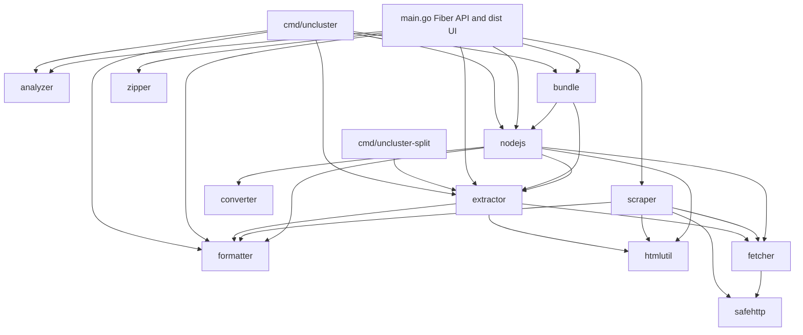

# Uncluster

[](https://github.com/omariomari2/uncluster/actions/workflows/ci.yml)
[](https://goreportcard.com/report/github.com/omariomari2/uncluster)
[](https://github.com/omariomari2/uncluster/blob/main/go.mod)
[](LICENSE)

Uncluster converts HTML into editable web projects using fixed rules, not a language model.

It is written in Go and provides a command-line tool, an API, and a browser interface. It can separate CSS and JavaScript, collect page assets, and generate React or Express/EJS projects.

**Live demo:** [https://uncluster-production.up.railway.app/how-it-works.html](https://uncluster-production.up.railway.app/how-it-works.html)

## Features

- Format and normalize HTML
- Split inline and external CSS and JavaScript into separate files, rewriting the HTML to match
- Scrape a public HTTP(S) page and localize CSS, JavaScript, images, fonts, and other referenced assets
- Generate a React 18 + Vite + TypeScript project, or an Express + EJS project
- Bundle a local HTML file or ZIP into the original page, split output, and an EJS project
- Analyze HTML for repeated semantic UI patterns and emit JSON suggestions
- Expose the same operations over a Fiber API and a static browser UI

The conversion uses fixed rules. It does not use a language model. TSX generation is deterministic: it preserves nodes, attributes, source order, text, and significant whitespace while translating HTML syntax to React-valid TSX.

## Example

Input HTML is converted to a React component. This output is produced by `ConvertSectionToTSX` on the fixture in `internal/converter/testdata/basic-structure.html`:

```html
<section class="hero" id="top">
  <h1>Welcome</h1>
  <p>A short paragraph of text.</p>
  <div class="actions">
    <a href="/signup" class="btn primary">Sign up</a>
    <a href="/docs">Read the docs</a>
  </div>
</section>
```

```tsx
function Hero(): JSX.Element {
  return (
    <section className="hero" id="top">
      <h1>Welcome</h1>
      <p>A short paragraph of text.</p>
      <div className="actions"><a href="/signup" className="btn primary">Sign up</a><a href="/docs">Read the docs</a></div>
    </section>
  )
}

export default Hero
```

Split mode extracts inline resources and rewrites references. For a page with `<style>h1{color:navy}</style>` and `<script>console.log("hi")</script>`, `extractor.Extract` writes `inline/style-1.css` and `inline/script-1.js`, and the HTML becomes:

```html
<link rel="stylesheet" href="inline/style-1.css" />
...
<script src="inline/script-1.js"></script>
```

## Install

Use Go 1.21 or later. Use Node.js 18 or later to run a generated Vite project.

```sh
git clone https://github.com/omariomari2/uncluster.git
cd uncluster
```

Install the CLI with the Makefile, or run it in place:

```sh
make install
uncluster --help
```

`make build` writes `./uncluster`. `make build-server` writes `./uncluster-server`. `make uninstall` removes the installed CLI.

## Usage

Run these commands from the repository directory.

Start the API and browser UI:

```sh
go run .
```

Open `http://localhost:3000`. The server uses `PORT` when set and otherwise listens on port `3000`.

To use the command-line tool:

```sh
go run ./cmd/uncluster --help
go run ./cmd/uncluster ./page.html -to nodejs -out ./react-site
```

Replace `page.html` with an HTML file you can use. Other formats:

```sh
go run ./cmd/uncluster ./page.html -to format
go run ./cmd/uncluster ./page.html -to split -out ./split-output
go run ./cmd/uncluster ./page.html -to nodejs-ejs -out ./ejs-site
go run ./cmd/uncluster ./page.html -to analyze
go run ./cmd/uncluster ./capture.zip -to bundle -out ./sites
```

`-to` is required. `-out` sets the output directory (defaults are `./split-output`, `./nodejs-project`, `./nodejs-ejs-project`, and `./bundle-output`). `-dest` is valid only with `-to bundle` and selects the exact final directory.

The primary CLI processes local files. URL capture is exposed through the API and browser UI.

There is also a narrower extraction-only CLI:

```sh
go run ./cmd/uncluster-split -input ./page.html -output ./split-output -manifest=true
```

Command, API, and output-format details are in [docs/usage.md](docs/usage.md). The command-line source is [cmd/uncluster/main.go](cmd/uncluster/main.go). Pipeline internals are described in [docs/ARCHITECTURE.md](docs/ARCHITECTURE.md).

## Architecture



Raw HTML goes through `extractor` (inline collection in `htmlutil`, remote stylesheets and scripts in `fetcher`, HTML rewrite and `formatter`). Public URLs go through `scraper`, which uses `safehttp` and `fetcher` to localize assets and returns the same `extractor.ExtractedContent` shape. Local HTML or ZIP inputs go through `bundle`, which selects an `index.html`, copies local assets, and writes split output plus an EJS project. React output is assembled by `nodejs` using `converter` for HTML-to-TSX translation. Split API exports are packed by `zipper`. `analyzer` is independent of TSX conversion.

## Project layout

```text
.
|-- main.go                 Fiber API server and static UI
|-- cmd/uncluster/          Primary multi-mode CLI
|-- cmd/uncluster-split/    Extraction-only CLI
|-- dist/                   Browser UI served at /
|-- docs/                   Usage and architecture notes
|-- internal/
|   |-- analyzer/           Repeated-pattern component suggestions
|   |-- bundle/             Local HTML or ZIP intake and packaging
|   |-- converter/          HTML fragment to TSX
|   |-- extractor/          Resource extraction and link rewriting
|   |-- fetcher/            Remote text and binary downloads
|   |-- formatter/          DOM-based HTML formatting
|   |-- htmlutil/           DOM helpers and inline resource collection
|   |-- nodejs/             React/Vite and EJS project generation
|   |-- safehttp/           URL checks, SSRF-resistant dialing, size limits
|   |-- scraper/            Public page capture and asset localization
|   `-- zipper/             Split archive creation
|-- Makefile
|-- go.mod
`-- nixpacks.toml
```

## Testing

```sh
go build ./...
go vet ./...
go test ./...
go test -race ./...
```

CI runs `go vet`, `go test -race`, and golangci-lint on every push and pull request to `main`.

## Current limits

Conversion preserves page structure instead of inferring application behavior. Review generated components, dependencies, and asset rights before deployment.

Remote requests have destination checks and download limits. These controls do not establish permission to copy a website.

## License

This project is licensed under the [MIT License](LICENSE). Copyright (c) 2026 Bright Omari Owusu.
